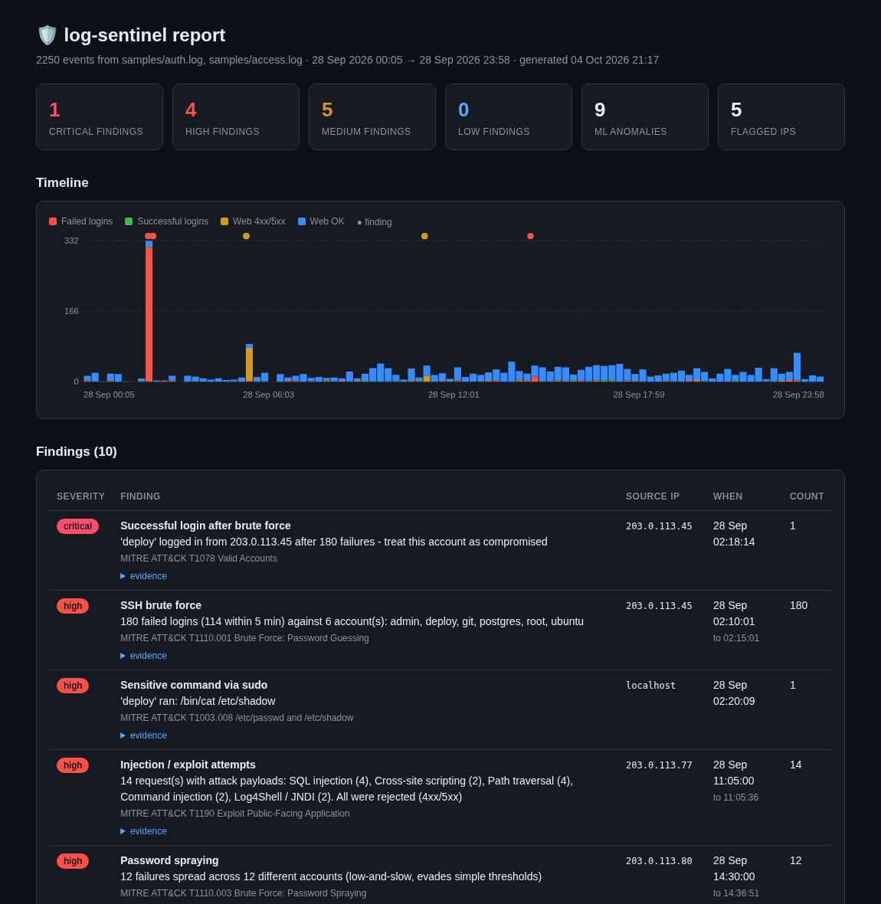
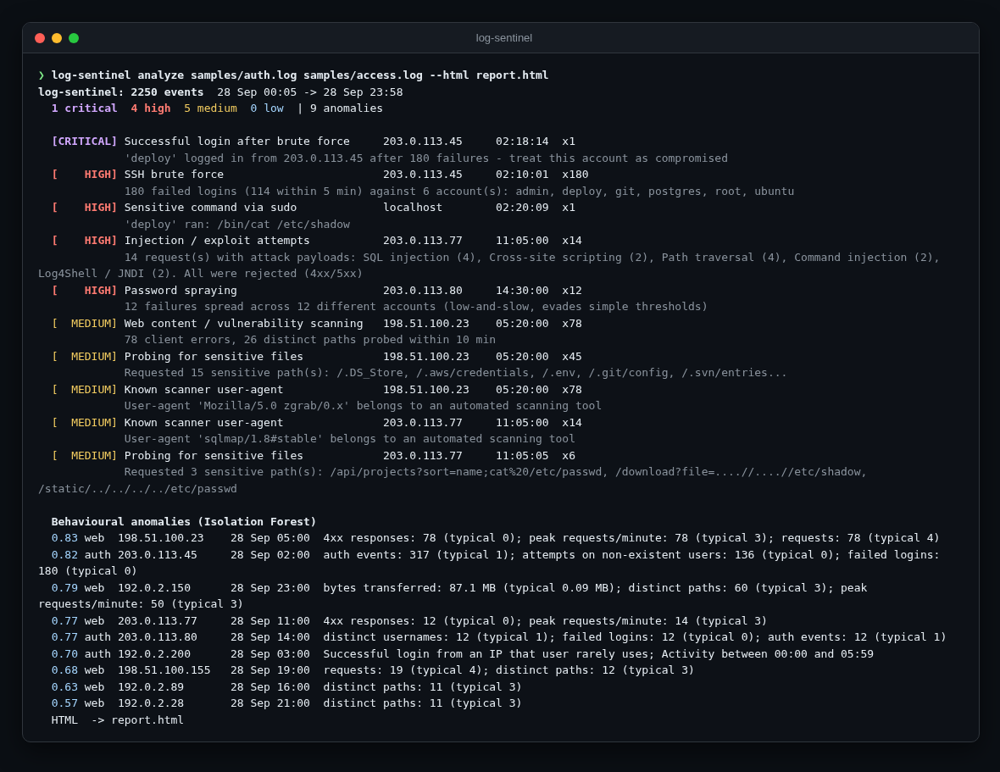

<div align="center">

# 🛡️ log-sentinel

**Security log anomaly detection for SSH auth logs and web access logs. Precise detection rules for known
attacks, an Isolation Forest for the strange stuff, and a self-contained HTML report.**

[](https://github.com/hbtabi/log-sentinel/actions/workflows/ci.yml)


[](LICENSE)

</div>

Point it at `/var/log/auth.log` and your Nginx/Apache access log and you get back a ranked list of what deserves
attention: brute force, password spraying, a login that worked *after* a brute force, scanners, injection
payloads. Each finding comes with evidence lines and a MITRE ATT&CK technique. The ML layer covers what rules
miss, like a valid login at 3am from an IP that user never uses, or one client pulling 80 MB from your API.

## 📸 Demo

<p align="center"></p>

<details><summary>Terminal output</summary>
<p align="center"></p>
</details>

## ✨ Features

**Detection rules** (deterministic, tunable, with evidence):

| Rule | Severity | ATT&CK |
|---|---|---|
| SSH brute force (N failures in a sliding window) | high | T1110.001 |
| **Successful login after brute force** (same IP) | critical | T1078 |
| Password spraying (many accounts, few tries each) | high | T1110.003 |
| Sensitive `sudo` commands (`/etc/shadow`, `useradd`...) | high | T1003.008 |
| Web content / vulnerability scanning (4xx bursts over many paths) | medium | T1595.003 |
| Probing for sensitive files (`/.env`, `/.git/`, `wp-login.php`...) | medium | T1083 |
| Injection payloads: SQLi, XSS, path traversal, command injection, Log4Shell | high, critical if 2xx | T1190 |
| Known scanner user-agents | medium | T1595 |

**Behavioural anomalies.** Events are grouped per IP per time window and turned into features (failures,
distinct users, a one-off IP for an established user, off-hours activity, 4xx/5xx counts, distinct paths, bytes,
peak requests/minute). Auth and web each get their own Isolation Forest. Every anomaly says *why* it stands out,
using robust z-scores against the median window, and windows that are only unusually *quiet* get filtered out.

**Reporting.** A colour terminal summary, `--json` for SIEM/pipelines, and `--html` for a single-file report
(inline SVG timeline, no JavaScript, no CDN, attacker payloads safely escaped). `--fail-on high` returns exit
code 1 for cron/CI alerting. `--llm` adds an optional executive summary via any OpenAI-compatible API.

## 🚀 Quick start

```bash
git clone https://github.com/hbtabi/log-sentinel && cd log-sentinel
python -m venv .venv && source .venv/bin/activate
pip install -e ".[dev]"

# bundled synthetic logs (24h, attacks injected, documentation-range IPs only)
log-sentinel analyze samples/auth.log samples/access.log --html report.html

# your own logs
sudo log-sentinel analyze /var/log/auth.log /var/log/nginx/access.log --html report.html --json findings.json
log-sentinel analyze /var/log/auth.log --brute-threshold 5 --fail-on high   # alerting

# generate fresh test data
log-sentinel simulate --out /tmp/sim --hours 48 --seed 3
```

## 🧠 How it works

```
auth.log ─┐   parsers.py            rules.py                      ┌─ terminal summary
          ├─► normalised Events ─┬─► sliding-window rules ──────┐ ├─ report.json
access.log┘                      └─► per-IP windows ─► IsolationForest ─► explain ─┴─ report.html
```

- `parsers.py`: OpenSSH syslog (classic and ISO-8601 timestamps), sudo, Nginx/Apache combined log, format auto-detection
- `rules.py`: sliding-window counters per IP, URL-decoding (twice) before payload matching
- `anomaly.py`: feature windows, Isolation Forest, robust-z explanations, noise filters
- `report.py` + `templates/report.html`: Jinja2 with autoescaping, hand-built SVG chart
- `simulate.py`: seeded generator for realistic traffic plus brute force, spray, scanner, injection, exfil, rare login

## 🗂️ Project structure

```
logsentinel/   parsers, rules, anomaly, analyze, report, simulate, llm, cli
samples/       auth.log + access.log generated by `log-sentinel simulate` (~370 KB)
tests/         parsers, detection coverage of every injected attack, CLI/HTML (incl. XSS escaping)
docs/          screenshots
```

## 🛣️ Roadmap

- [ ] More sources: journald JSON, Windows Security events (4625/4624), AWS CloudTrail
- [ ] GeoIP / ASN enrichment (offline MaxMind DB, optional)
- [ ] Follow mode (`--follow`) with incremental windows for near-real-time alerting
- [ ] Persisted baselines, so the forest learns "normal" from last week, not from the same file
- [ ] Sigma rule export for findings

## ⚠️ Limitations

- The bundled logs are **synthetic**, so detection recall on them is not a benchmark. Real logs are messier.
- The Isolation Forest learns "normal" from the file it's analysing. With very little data (fewer than 20
  windows) it's skipped, and with a long-running attack inside the data it may treat that attack as normal.
- On the sample data the forest also flags 2–3 busy but harmless visitors with low scores. That's the cost of
  unsupervised detection, so treat low-scored anomalies as leads, not alerts.
- Syslog lines carry no year (`--year`) and no timezone. Everything is treated as local naive time.
- It's a triage tool, not a SIEM: no persistence, correlation across hosts, or automatic blocking.

## 📄 License

[MIT](LICENSE) © 2026 Mohammed Hassan bin Tayyeb
